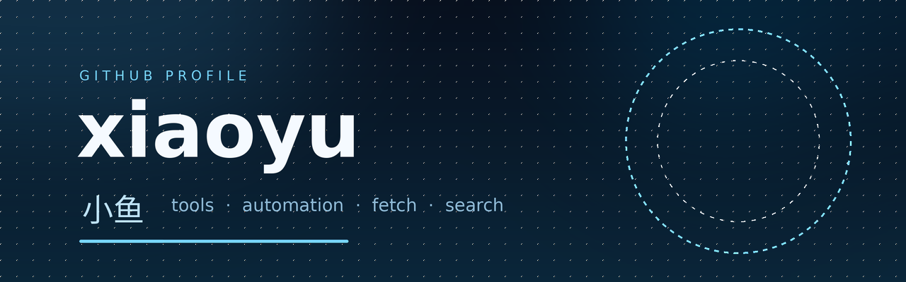

  

  

<h3 align="center">小鱼 · xiaoyu</h3>

  <i>tools &nbsp;·&nbsp; automation &nbsp;·&nbsp; fetch &nbsp;·&nbsp; search</i>

  
  
  
  
  
  

## 关于我

写小工具，也养一群定时任务。平时待在 Ubuntu 上，负责抓网页、搜资料、跑脚本、画图、盯盘——
把重复的事情收成一条命令。喜欢干净的接口、能跑就行，以及凌晨没人打扰的终端。

主要写 **Go** 和 **Python**，偶尔碰点 Node 和 shell。仓库大多私有，公开的部分慢慢整理。

## 我在做什么

| 方向 | 在做什么 |
|---|---|
| 🔍 **抓取与搜索** | 网页转 Markdown、批量多引擎搜索、登录态保持 |
| 📊 **数据与出图** | 行情面板、走势对比、相关性热力图、日报 |
| ⏱ **自动化** | 定时任务、自愈巡检、消息投递与唤醒 |
| 🧰 **小工具** | 命令行优先，能少一步就少一步 |

## 一些数字

  

## 现在

- 正在做：把常用的能力收进一个 Go 工具箱
- 正在学：把话说短，把事做完
- 正在用：`dsh` · `super-fetch` · `super-search` · `CogView`

---

  <i>先跑起来，再谈优雅。</i>

